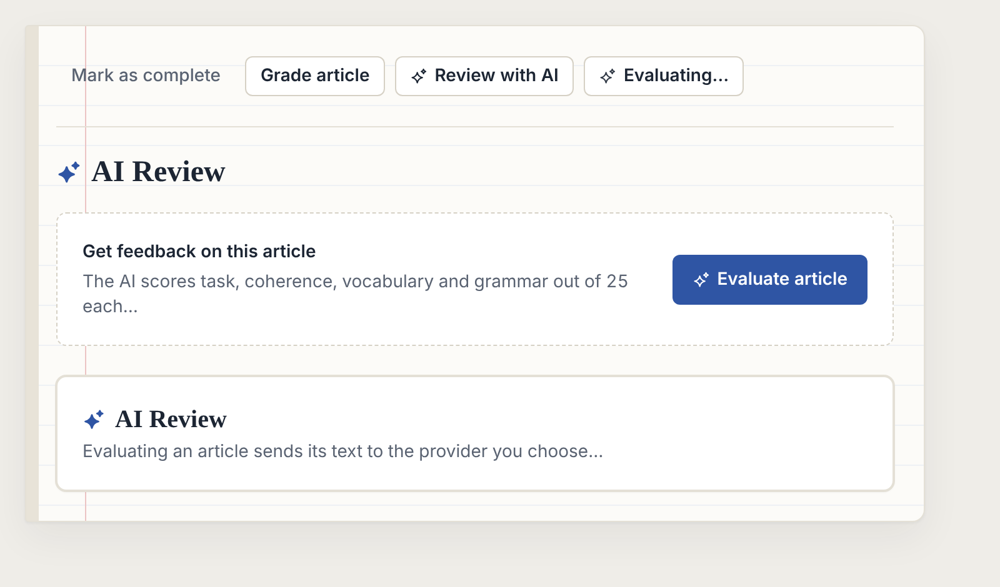

# AI icon

## Problem
The AI features ("Review with AI", "Evaluate article", the AI Review panel and the AI section in Settings) used the
**star** icon. A star says "favourite", which is what it already means in the vocabulary list, and says nothing about AI.
People need to tell at a glance which actions send text to an AI and which don't.

## Existing patterns
| Related icon | Similarity | Why it isn't enough |
|---|---|---|
| `star` | Was used for the AI buttons | Means "starred" in the word list; two meanings for one shape |
| `pen`, `edit` | Writing context | Say "edit by hand", not "AI" |

## Options considered
All drawn on the app's grid (24 px box, 1.8 stroke, round caps and joins) and checked at 14, 16, 20, 24 and 40 px in
both themes ([sheet](ai-icon-options.png)).

| Option | Verdict |
|---|---|
| A. Large + small sparkle | **Chosen.** Reads as "AI" immediately; the small sparkle stays visible at 14 px |
| B. Single sparkle | Clear but plain; little identity of its own |
| C. Sparkle with a "+" | The plus is crisp but reads as "add" |
| D. Chat bubble + sparkle | The sparkle turns to mush at 14 px |
| E. Pen + sparkle | Fits the writing context but is busy at small sizes |
| F. Notebook + sparkle | Muddy at 14 px |
| G. Current star | Wrong meaning |

A was then refined ([sheet](ai-icon-refinement.png)): the sides of the stars were made more concave so they read as
sparkles rather than diamonds. **A2** keeps the points sharp at 14 px.

## The icon
Component name: `ai` (`<Icon Name="ai" />`). Standalone files: [`ai-icon.svg`](ai-icon.svg) (filled, accent colour) and
[`ai-icon-outline.svg`](ai-icon-outline.svg) (outline, `currentColor`).

### Variants
| Variant | Markup | Use when |
|---|---|---|
| Outline | `<Icon Name="ai" Size="14"/>` | Inside buttons and inline with text |
| Filled | `<Icon Name="ai" Size="20" Fill="true"/>` inside `text-nt-accent` | Beside a section heading (AI Review panel, Settings) |

### States
| State | Look |
|---|---|
| Default | `currentColor`, so it follows the button's text colour |
| Working | `animate-pulse motion-reduce:animate-none` while the AI is evaluating |
| Disabled | Inherits the button's disabled opacity |

### Sizes
14 px in buttons (same as the other 14 px button icons), 18-20 px beside headings. Below 14 px the small sparkle blurs:
don't go smaller.

### Tokens used
Colour: `currentColor`; `text-nt-accent` for the filled heading variant (contrast against the page is 3:1 or better in
both themes). Stroke 1.8 on a 24 px grid, `stroke-linecap` and `stroke-linejoin` round, like every icon in the set.

## Accessibility
- The icon is decorative (`aria-hidden="true"` is set by the `Icon` component). The button's text carries the meaning
  ("Review with AI"), so never use the icon alone without a text label or `aria-label`.
- Don't rely on colour: the shape is what identifies it.
- The working state respects `prefers-reduced-motion`.

## Do and don't
| Do | Don't |
|---|---|
| Use `ai` for anything that sends text to an AI provider | Use it for ordinary "magic" or "auto" actions that don't call an AI |
| Keep one AI icon everywhere so it is recognised | Mix it with the star or draw a second AI mark |
| Pair it with a text label | Use it alone as the only label of a button |

## Where it is used
`WritingEditor` (the "Review with AI" and "Evaluate article" buttons, the AI Review heading),
`WritingAiReviewPanel` (heading), `Settings` (AI Review section heading). `star` is now only for favourites.

## Open questions
- A distinct mark for the app itself (favicon, logo) is a separate piece of work; this icon is for the interface.
- If more AI actions appear (for example suggesting words), decide whether they share this icon or get a small badge on
  their own icon.
